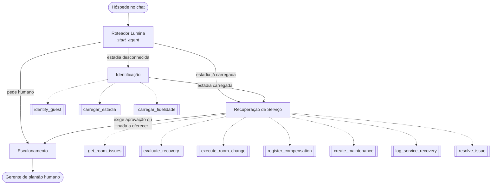

# Concierge Lumina — Agente de IA para atendimento hoteleiro

> Agente autônomo construído no **Salesforce Agentforce** que resolve, por chat, problemas de hóspedes durante a estadia: identifica o hóspede, encontra a ocorrência, calcula a recuperação permitida pela política, troca o quarto com confirmação, aplica cortesia, abre manutenção e encerra o caso. Quando a política exige aprovação, ele passa o atendimento a um gerente humano.


## O problema

Um hóspede relata que o ar-condicionado do quarto parou. Para resolver, normalmente seria preciso:

1. descobrir quem é o hóspede e qual é a estadia ativa;
2. achar o chamado aberto daquele quarto;
3. ver o que a política permite oferecer, que depende do nível de fidelidade e da disponibilidade;
4. trocar o quarto, compensar o hóspede, acionar a manutenção e fechar o caso.

O **Concierge Lumina** faz esse fluxo inteiro sozinho. Ele **não decide nada fora da política**: tudo o que o agente oferece vem de actions governadas.

## Arquitetura



| Subagente | Responsabilidade |
|---|---|
| **Roteador Lumina** | Só direciona a conversa. Se a estadia já está carregada, vai direto para a recuperação (`before_reasoning`, de forma determinística). |
| **Identificação** | Identifica o hóspede pela sessão ou por nome / número de fidelidade e carrega a estadia e o nível de fidelidade. Se a busca for ambígua, pede mais um dado. |
| **Recuperação de Serviço** | Localiza a ocorrência, avalia as opções, troca o quarto **com confirmação**, aplica a cortesia, abre a manutenção, registra a recuperação e resolve o caso. |
| **Escalonamento** | Passa o atendimento a um gerente humano, sem prometer resultados nem prazos. |

As **10 actions** são Salesforce Flows (`Lumina_Act_*`). A troca de quarto é **transacional e idempotente**.

## Guardrails (o que impede o agente de errar)

- **Sem alucinação:** todo fato que o agente afirma (quarto, disponibilidade, valor) vem do retorno de uma action.
- **A política decide, não o LLM:** quem define o que pode ser oferecido é a `evaluate_recovery`. O agente só repassa o que veio marcado como permitido.
- **Actions liberadas por estado:** cada action tem uma condição `available when` ligada às variáveis da conversa. Por exemplo, `trocar_quarto` só aparece se houver quarto elegível, se não for preciso aprovação e se a troca ainda não tiver sido feita. Assim o agente não pula etapas nem repete uma ação.
- **Confirmação antes de ações irreversíveis:** `require_user_confirmation: True` na troca de quarto.
- **Humano no circuito:** se a política exige aprovação, ou se não há nada a oferecer, o atendimento vai para um gerente de plantão.
- **Privacidade:** a identidade vem da sessão de mensagem. Um hóspede não consegue agir como outra pessoa, e IDs internos nunca aparecem para ele.

## Exemplo de conversa (ilustrativo)

*Substitua por um print real do Preview do Agentforce Builder.*

> **Hóspede:** O ar-condicionado do meu quarto parou de funcionar.
>
> **Concierge:** Sinto muito por isso. Vejo que o senhor está no quarto 412. Posso transferi-lo agora para um quarto mais fresco e tranquilo. Deseja que eu faça a troca?
>
> **Hóspede:** Sim, por favor.
>
> **Concierge:** Pronto! Seu novo quarto é o 418. A manutenção já está a caminho do quarto antigo e incluímos uma cortesia pela inconveniência. *Light, composed.*

## Estrutura do repositório

```
concierge-lumina/
├── agent/
│   └── Lumina_Guest_Service_Agent.agent   # definição completa em Agent Script
└── README.md
```

## Como reproduzir

1. Crie uma org com Agentforce habilitado (Trailhead Playground ou Developer Edition com Agentforce).
2. Crie os Flows `Lumina_Act_*` listados acima, com as entradas e saídas descritas no arquivo `.agent`.
3. No **Agentforce Builder**, crie um agente do tipo *Agentforce Service Agent*, mude para a visualização de script e cole o conteúdo de `agent/Lumina_Guest_Service_Agent.agent`.
4. Ajuste `default_agent_user` para o usuário do agente na sua org e, se quiser testar sem sessão de mensagem, coloque em `mock_id` o Id de um Contact de teste.

## Tecnologias

Salesforce Agentforce · Agent Script · Agentforce Builder · Salesforce Flows · Service Cloud (Cases) · Enhanced Messaging

## Autor

**Kauan Maciel Forgiarini** · [LinkedIn](https://linkedin.com/in/kauanforgiarini) · [GitHub](https://github.com/KauanForgiarini)
